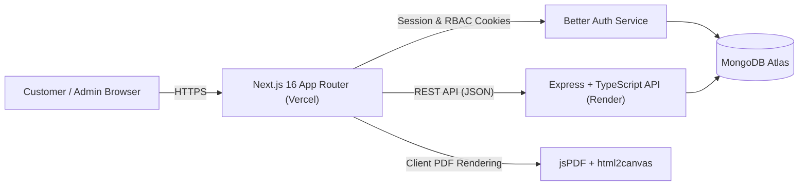

<div align="center">

# BorkaShop — Full-Stack Luxury Modest Fashion E-Commerce (Client)

**A production-ready, conversion-focused e-commerce storefront and executive admin suite built with Next.js 16 (App Router), React 19, TypeScript, and Tailwind CSS v4.**

[](https://borkashop.vercel.app)
[](https://github.com/eyasinarafat3485-gif/BorkaShop-Backend)
[](https://nextjs.org/)
[](https://react.dev/)
[](https://www.typescriptlang.org/)
[](https://tailwindcss.com/)
[](https://www.better-auth.com/)

[Live Storefront](https://borkashop.vercel.app) • [Backend Repository](https://github.com/eyasinarafat3485-gif/BorkaShop-Backend) • [Architecture](#-system-architecture) • [Engineering Highlights](#-engineering-highlights) • [Local Setup](#-getting-started)

</div>

---

## Overview

**BorkaShop** is a full-stack modest fashion e-commerce application engineered for speed, high conversion, and operational scalability. Designed with a refined editorial aesthetic and bilingual typography (`Inter`, `Playfair Display`, and `Hind Siliguri` for Bengali/English support), the client application delivers a seamless shopping experience alongside a complete, URL-driven Admin Back-Office.

> **Note:** This repository contains the **Next.js Frontend Client**. It communicates with the dedicated Express/TypeScript REST API & Better Auth server hosted in the [BorkaShop Backend Repository](https://github.com/eyasinarafat3485-gif/BorkaShop-Backend).

---

## System Architecture



---

## Engineering Highlights

Key architectural decisions implemented in this codebase to meet production reliability and maintainability standards:

- **Strict Guest-to-Member Session Isolation:** `ShopContext` isolates guest activity via device-scoped identifiers and authenticated members strictly by verified email identity, preventing cart, wishlist, or order history leakage when new users sign up on shared devices.
- **Hybrid Persistence & Optimistic UI:** Shopping carts, quick orders, and store configuration (`storesettings`) sync with MongoDB Atlas while preserving instant responsiveness through resilient client state.
- **Zero-Friction 1-Click Quick Order & Dynamic Shipping:** Customers can place guest Cash-on-Delivery orders directly from product cards or detail pages (`QuickOrderModal`), while checkout dynamically calculates Inside/Outside Dhaka fees and free-shipping thresholds from live admin settings.
- **Client-Side PDF Invoice Engine:** Built an automated, downloadable order invoice generator (`OrderInvoiceModal`) using `jspdf` and `html2canvas` with Tailwind v4 color-space normalization (`oklch`/`lab` safe rendering) for consistent print fidelity across browsers.
- **URL-Driven Modular Admin Suite (`/admin/[slug]`):** 13 dedicated administrative modules—inventory, variants/attributes, brands, categories, tags, orders, CRM, review moderation, analytics, notifications, and store settings—mapped directly to clean Next.js dynamic routes.
- **Performance & Core Web Vitals Focus:** Configured Next.js `<Image />` remote domains, font preloading with `display: swap`, Turbopack CSS compilation, and Lenis smooth scrolling.

---

## Core Capabilities

### Customer Storefront
- **Editorial Storefront & Discovery:** Hero slider, category showcases, New Arrivals, Best Sellers, live global search modal (`SearchModal`), and category pages (`/product-category/[category]`).
- **Interactive Product Experience:** High-resolution image zoom (`ProductImageZoom`), size/color variant selection, dedicated Size Guide (`/size-guide`), direct WhatsApp ordering, and live stock indicators.
- **Slide-Out Cart & Order Tracking:** Persistent slide-out `CartDrawer` with free-delivery progress tracking and an instant `TrackOrderModal` for checking live order statuses.
- **Verified Product Reviews:** Dynamic review submission and listing connected to MongoDB Atlas, supporting both logged-in customer profiles and guest submissions.
- **Customer Portal (`/dashboard`):** Order history tracking, profile/delivery-area management, and real-time account notifications (`/dashboard/notifications`).

### Executive Admin Dashboard (`/admin`)
- **Overview & Revenue Analytics:** Real-time store KPIs, revenue summaries, and order distribution insights (`OverviewTab`, `AnalyticsTab`).
- **Catalog & Taxonomy Management:** Full CRUD workflows for products (`ProductsTab`, `AddProductTab`, `EditProductModal`), `CategoriesTab`, `BrandsTab`, `TagsTab`, and `AttributesTab`.
- **Order Fulfillment & PDF Invoices:** Order status pipeline (`Pending` → `Processing` → `Shipped` → `Delivered` / `Cancelled`) with 1-click printable/downloadable PDF invoices (`OrderInvoiceModal`).
- **Customer CRM & Notifications:** Customer directory with lifetime spend and order counts (`CustomersTab`), alongside an event-driven admin notification center (`NotificationsTab`).
- **Review Moderation & Dynamic Store Settings:** Approve or manage customer reviews (`ReviewsTab`) and update delivery fees, payment toggles (COD, bKash, Nagad, Rocket), and helpline contacts in real time (`SettingsTab`).

---

## Tech Stack

| Layer | Technology | Version / Role |
| :--- | :--- | :--- |
| **Framework** | [Next.js (App Router)](https://nextjs.org/) | `16.4.3` — Hybrid SSR/CSR routing, metadata API, image optimization |
| **UI Library** | [React](https://react.dev/) | `19.3.0` — Concurrent rendering & modular hooks |
| **Language** | [TypeScript](https://www.typescriptlang.org/) | `^5` — Strict end-to-end type safety (`src/types/index.ts`) |
| **Styling** | [Tailwind CSS](https://tailwindcss.com/) | `^4` with `@tailwindcss/turbopack` |
| **Authentication** | [Better Auth](https://www.better-auth.com/) | `^1.7.14` — Session cookies, role-based access (`user`, `admin`) |
| **State Management** | React Context API | Centralized `ShopContext` synced with backend REST endpoints |
| **PDF Invoices** | `jspdf` & `html2canvas` | `^4.2.1` / `^1.4.1` — Client-side printable & downloadable invoices |
| **UX & Polish** | `lenis`, `react-hot-toast`, `react-icons` | Smooth scrolling, toast notifications, and vector iconography |

---

## Project Structure

```text
Frontend/
├── public/                         # Static assets, SVG payment badges, brand assets
├── src/
│   ├── app/                        # Next.js App Router pages & layouts
│   │   ├── admin/                  # Admin Dashboard & dynamic [slug] routes
│   │   │   └── components/         # 17 modular admin tabs & invoice/edit modals
│   │   ├── product/[slug]/         # Dynamic SEO-friendly product detail pages
│   │   ├── product-category/[category]/ # Category catalog pages
│   │   ├── shop/                   # Full filterable & searchable store catalog
│   │   ├── new-arrivals/           # Latest collection showcase
│   │   ├── best-sellers/           # Top-performing products showcase
│   │   ├── checkout/               # Guest & authenticated checkout flow
│   │   ├── dashboard/              # Customer account portal & notifications
│   │   ├── size-guide/             # Interactive modest wear sizing chart
│   │   ├── login/ & register/      # Authentication pages (+ signin/signup aliases)
│   │   ├── about-us/, contact/, faq/ # Brand story, support & FAQ pages
│   │   ├── layout.tsx              # Root layout, Google Fonts, global modals
│   │   └── not-found.tsx           # Custom 404 page with quick support links
│   ├── components/                 # Reusable storefront UI components
│   │   ├── Header.tsx, Footer.tsx, AdminBar.tsx
│   │   ├── HeroSlider.tsx, CategoriesSection.tsx, ProductCard.tsx
│   │   ├── ProductDetailsClient.tsx, ProductImageZoom.tsx
│   │   ├── CartDrawer.tsx, QuickOrderModal.tsx, TrackOrderModal.tsx
│   │   ├── SearchModal.tsx, AuthModal.tsx, LenisProvider.tsx
│   ├── context/
│   │   └── ShopContext.tsx         # Global store state, cart, orders & DB sync
│   ├── lib/
│   │   └── auth-client.ts          # Configured Better Auth React client
│   ├── data/
│   │   └── products.ts             # Fallback catalog & static store metadata
│   └── types/
│       └── index.ts                # Shared TypeScript interfaces
├── next.config.ts                  # Image remote patterns & Turbopack rules
├── package.json
└── tsconfig.json
```

---

## Application Routes

| Route | Access | Description |
| :--- | :--- | :--- |
| `/` | Public | Editorial storefront homepage with hero slider, collections & reviews |
| `/shop` | Public | Complete catalog with filtering, sorting, and live search |
| `/new-arrivals` | Public | Newly added collections |
| `/best-sellers` | Public | Most popular items |
| `/product/[slug]` | Public | Product details, image zoom, size guide, reviews & quick order |
| `/product-category/[category]` | Public | Category-filtered product showcase |
| `/checkout` | Public / Member | Dynamic shipping rate calculation & COD/mobile-banking checkout |
| `/size-guide` | Public | Modest fashion sizing reference |
| `/login` / `/register` | Guest | User sign-in and account registration |
| `/dashboard` | Authenticated | Customer profile, saved delivery address, and order history |
| `/admin` | Admin | Executive overview dashboard |
| `/admin/[slug]` | Admin | `all-products`, `add-product`, `brands`, `categories`, `tags`, `attributes`, `orders`, `customers`, `reviews`, `notifications`, `analytics`, `settings` |

---

## Getting Started

### Prerequisites

- **Node.js** `v20+` (LTS recommended)
- **npm** (or `pnpm` / `yarn`)
- Running instance of the [BorkaShop Backend](https://github.com/eyasinarafat3485-gif/BorkaShop-Backend) (or configured remote API URL)

### 1. Clone & Install

```bash
git clone https://github.com/eyasinarafat3485-gif/BorkaShop-Frontend.git
cd BorkaShop-Frontend
npm install
```

### 2. Configure Environment Variables

Create a `.env.local` file in the root of the project:

```env
# REST API base URL (local backend or deployed Render URL)
NEXT_PUBLIC_API_URL=http://localhost:5000/api

# Better Auth server origin (without /api suffix)
NEXT_PUBLIC_AUTH_URL=http://localhost:5000
```

> If `NEXT_PUBLIC_API_URL` or `NEXT_PUBLIC_AUTH_URL` are omitted, the client falls back to the deployed production backend (`https://borkashop-backend.onrender.com`).

### 3. Run Locally

```bash
npm run dev
```

Visit [http://localhost:3000](http://localhost:3000) in your browser.

---

## Available Scripts

| Command | Description |
| :--- | :--- |
| `npm run dev` | Starts the Next.js development server with Turbopack on port `3000` |
| `npm run build` | Creates an optimized production build |
| `npm run start` | Serves the production build |
| `npm run lint` | Runs ESLint across the codebase |

---

## Deployment

- **Frontend:** Deployed on **Vercel** with automatic CI/CD builds triggered on pushes to `main`.
- **Backend & Auth:** Deployed on **Render** (`https://borkashop-backend.onrender.com`) connected to **MongoDB Atlas**.

---

## Author

**Eyasin Arafat**
- GitHub: [@eyasinarafat3485-gif](https://github.com/eyasinarafat3485-gif)
- Live Project: [borkashop.vercel.app](https://borkashop.vercel.app)

  
---

<div align="center">
  <sub>Built with Next.js 16, React 19, TypeScript, and Tailwind CSS v4.</sub>
</div>
